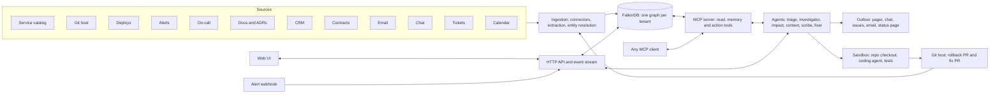

# Ripple — plan

Working name. An incident does not stop at the service that broke; it ripples into customers,
contracts, promises and decisions. Ripple is an incident-response agent team that follows it all
the way, on one graph of the company.

Hackathon: Graph Hacks (WeMakeDevs × FalkorDB), Oct 15 12:01 AM → Oct 18 11:59 PM IST.
Entering all three tracks with one project. No commits before Oct 15.

---

## 1. Positioning

| Who | What they graph | Where they stop |
|---|---|---|
| AI SRE tools (Resolve.ai, Cleric, Anyshift, Causely, Traversal, IncidentFox) | Infrastructure: services, pods, telemetry | "This deploy caused it" |
| Company brains (Almanac, Hyper, GBrain) | Organisation: docs, email, chat, decisions | They answer questions; they do not investigate |
| **Ripple** | Both, joined in one graph | Root cause → customers hit → SLA exposure → promises made → decision behind the change → who to tell → a rollback and a proper fix, both ready to merge |

One-line pitch: **the incident agent that keeps going after the root cause, until the fix is merged.**

Why the graph is the product (rule 3): every answer is a path. Tools are Cypher queries, agent
memory is a subgraph, agent coordination is a subgraph, tenant isolation is one graph per tenant.
Remove FalkorDB and there are no tools, no memory, no shared state and no evidence.

---

## 2. Demo story (3 minutes, start to finish)

The synthetic company is **Northwind Pay**, a B2B payments API with merchant customers on SLA contracts.

1. **Sources screen.** Twelve connected sources, each showing what it contributed to the graph.
   We connect one more live (a contracts folder) and watch nodes appear.
2. **Alert fires.** `checkout-api` 5xx rate crosses threshold. An incident room opens by itself.
3. **Recall.** Triage agent finds one resolved incident on the same dependency chain and a
   playbook learned from it. Shown as "I have seen something like this".
4. **Technical walk.** `checkout-api → payments-core → ledger-db`. A PR merged 90 minutes ago
   lowered the ledger connection pool. The graph path lights up as the agent walks it.
5. **Why.** That PR implements ADR-7, decided last week by the platform lead, superseding ADR-3.
   ADR-7's own risk section predicted this failure. Shown with the quoted sentence and its source.
6. **Business ripple.** `checkout-api` serves the Hosted Checkout feature, used by 14 customers.
   Three have a 99.95% SLA; one is mid-way through a sale event listed in the shared calendar;
   the account manager promised that customer "zero downtime during the sale" in an email on Sep 30.
   SLA credit exposure is computed and shown.
7. **Actions, with approval.** Page the on-call owner. Draft three different customer notices
   (the one with the promise gets a different message and goes via their account manager).
   Draft the status-page update. A human approves; actions execute.
8. **Two ways out, both ready.** Side by side in the incident room:
   - **Rollback**: a revert PR of the pool change, ready in seconds. Flagged by the graph:
     "restores checkout, but re-opens the ledger overload risk ADR-7 was written to prevent (INC-088)".
   - **Proper fix**: a coding agent, given the graph context, writes a PR that keeps ADR-7's cap
     and adds what it was missing (bounded wait queue and a pool sized per replica), with a
     regression test that reproduces the incident. Tests pass in the sandbox. Reviewers are
     suggested from the expertise query. The PR description cites the graph path.
9. **Approve and merge.** The on-call merges the rollback now to stop the bleeding, and the
   proper fix goes to review. On merge the deploy runs, the alert clears, the incident resolves,
   and the new PR is ingested with a `FIXES` edge.
10. **Close and learn.** Human confirms the root cause. The postmortem is drafted with a timeline,
    then ingested back as a source. A fact and a playbook (including the fix pattern) are written to memory.
11. **Second incident.** A similar alert on another service resolves in a third of the tool
    calls because the playbook is recalled. Counter on screen: 14 tool calls → 5.
12. **Not staged.** Evaluation screen: 20 generated incidents with hidden ground truth,
    root-cause accuracy with and without memory.

---

## 3. Track mapping

| Track | Requirement in the brief | Where Ripple does it |
|---|---|---|
| 1. Agents That Act | Multi-hop reasoning | Suspect walk, business ripple, decision trace (sections 8, 12) |
| | Graph queries as agent tools | Every read tool is a named Cypher query (section 8) |
| | Tool selection through MCP | All tools served by one MCP server; the agent is an MCP client (section 8) |
| | Action-taking | Page, notices, status page, postmortem, plus a rollback PR and a fix PR, behind an approval gate (sections 9, 9.6) |
| | Explainable results | Every claim must cite a path returned by a tool; uncited claims are rejected (section 9.4) |
| 2. Memory and Coordination | Episodic, semantic, procedural memory | Investigation trace, learned facts, playbooks (section 10) |
| | Persistent conversation history | Session and Message nodes per user (section 10.4) |
| | Shared state between agents | Blackboard subgraph: tasks, hypotheses, findings (section 9.2) |
| | High concurrency | Atomic task claim in one Cypher statement; load test across tenants (section 11) |
| | Isolated memory per user or tenant | One graph per tenant; user-anchored subgraph inside it (section 11) |
| 3. Company Brain | People, teams, projects, docs, decisions in one graph | Section 5 |
| | Multiple sources | Twelve connectors at MVP, more as stretch (section 6) |
| | Ownership and expertise | OWNS, ON_CALL_FOR, AUTHORED, expertise query (section 12) |
| | Tracing decisions | Decision nodes with SUPERSEDES chains and deciders |
| | Keeping knowledge current | Incremental sync, validity intervals, conflict queue, postmortem loop (section 7) |
| | Sourced answers | Every fact links to the source record it came from (section 5.3) |

---

## 4. Architecture



Five processes at most: FalkorDB, API (which also hosts the agents and the ingestion workers),
MCP server, web UI, and nothing else. One `docker compose up`.

---

## 5. Graph model

### 5.1 Company graph (the brain)

| Area | Node labels | Key properties |
|---|---|---|
| People | `Person`, `Team`, `Identity` | name, role; Identity holds one handle/email/chat id each |
| Engineering | `Service`, `Vendor`, `Repo`, `PR`, `Deploy`, `Alert`, `Incident`, `Runbook` | service tier; PR merged_at, risk flags; deploy env, at |
| Knowledge | `Doc`, `Decision`, `Requirement`, `Meeting`, `ActionItem` | doc type; decision status, decided_at, risk notes; requirement text, target, priority |
| Product | `Product`, `Feature` | name |
| Customers | `Customer`, `Contract`, `SLA`, `Ticket`, `Commitment`, `Event` | plan, monthly revenue; SLA uptime target, credit %; commitment text, due |
| Comms | `Email`, `Thread`, `Message` | sent_at, subject, body, embedding |
| Provenance | `Source`, `SourceRecord` | connector, uri, fetched_at, content hash |

Relationships:

```
(Person)-[:MEMBER_OF]->(Team)            (Person)-[:REPORTS_TO]->(Person)
(Person)-[:HAS_IDENTITY]->(Identity)     (Person)-[:ON_CALL_FOR {from, to}]->(Service)
(Team)-[:OWNS]->(Service)                (Service)-[:DEPENDS_ON {kind}]->(Service|Vendor)
(Repo)-[:BUILDS]->(Service)              (Person)-[:AUTHORED]->(PR)-[:CHANGES]->(Service)
(Person)-[:REVIEWED]->(PR)               (Deploy)-[:SHIPPED]->(PR)   (Deploy)-[:TO]->(Service)
(Alert)-[:FIRED_ON]->(Service)           (Incident)-[:AFFECTS]->(Service)
(Incident)-[:TRIGGERED_BY]->(Alert)      (Incident)-[:CAUSED_BY]->(PR|Deploy|Vendor)
(Runbook)-[:COVERS]->(Service)           (PR)-[:IMPLEMENTS]->(Decision)
(Person)-[:DECIDED]->(Decision)          (Decision)-[:SUPERSEDES]->(Decision)
(Decision)-[:RECORDED_IN]->(Doc|Meeting) (Person)-[:ATTENDED]->(Meeting)
(Requirement)-[:STATED_IN]->(Doc)         (Requirement)-[:APPLIES_TO]->(Feature|Service)
(Customer|Person)-[:REQUESTED]->(Requirement)   (PR)-[:IMPLEMENTS]->(Requirement)
(Product)-[:HAS]->(Feature)              (Feature)-[:SERVED_BY]->(Service)
(Customer)-[:USES]->(Feature)            (Customer)-[:HAS_CONTRACT]->(Contract)-[:GUARANTEES]->(SLA)
(SLA)-[:COVERS]->(Feature|Product)       (Person)-[:MANAGES_ACCOUNT]->(Customer)
(Ticket)-[:RAISED_BY]->(Customer)        (Ticket)-[:ABOUT]->(Feature)
(Person)-[:MADE]->(Commitment)-[:TO]->(Customer)   (Commitment)-[:ABOUT]->(Feature|Product)
(Customer)-[:HAS_EVENT]->(Event)         (Vendor)-[:HAS_CONTRACT]->(Contract)
(Person)-[:SENT]->(Email)-[:TO]->(Person|Customer)   (Email|Message|Doc)-[:MENTIONS]->(any entity)
```

### 5.2 Time

- Events carry a timestamp (`merged_at`, `at`, `sent_at`, `started_at`).
- Facts that can change carry `valid_from` and `valid_to` (null means current): ownership,
  on-call, dependencies, account manager, SLA terms.
- Investigation queries always filter by the incident's start time, so the agent reasons over the
  company as it was when things broke, not as it is now.

### 5.3 Provenance

- Every ingested node has `(node)-[:EVIDENCED_BY {quote, span}]->(SourceRecord)-[:FROM]->(Source)`.
- Every ingested relationship carries `src` (list of SourceRecord ids), `confidence` and
  `inferred` (true when an LLM extracted it from prose).
- An answer can only state a fact whose path ends in a SourceRecord. The UI shows the quote.

### 5.4 Investigation and coordination subgraph

```
(Incident)<-[:INVESTIGATES]-(Investigation {status, started_at})
(Investigation)-[:HAS_TASK]->(Task {kind, status, claimed_by, claimed_at})
(Investigation)-[:HAS_STEP]->(Step {agent, tool, params, summary, at})-[:NEXT]->(Step)
(Step)-[:TOUCHED]->(any entity)
(Investigation)-[:HAS_HYPOTHESIS]->(Hypothesis {statement, score, status})
(Hypothesis)-[:SUPPORTED_BY|CONTRADICTED_BY]->(any entity)
(Investigation)-[:HAS_FINDING]->(Finding {claim, kind})-[:CITES {order}]->(any entity)
(Investigation)-[:PROPOSED]->(Action {kind, payload, status, approved_by})-[:JUSTIFIED_BY]->(Finding)
(Investigation)-[:PROPOSED]->(Remediation {kind: 'rollback'|'fix', status, branch, tests, summary})
(Remediation)-[:REVERTS]->(PR)            (Remediation)-[:PRODUCED]->(PR)-[:FIXES]->(Incident)
(Remediation)-[:RESPECTS|REOPENS_RISK_OF]->(Decision)   (Remediation)-[:JUSTIFIED_BY]->(Finding)
(Decision)-[:GOVERNS]->(Service)
```

### 5.5 Memory subgraph

```
(Fact {text, confidence, valid_to, embedding})-[:ABOUT]->(entity)   (Fact)-[:LEARNED_IN]->(Investigation)
(Playbook {symptom, embedding, wins, losses})-[:HAS_STEP {order}]->(PlaybookStep {tool, param_template})
(Playbook)-[:LEARNED_IN]->(Investigation)   (Playbook)-[:APPLIES_TO]->(Service|Team)
(User)-[:HAD]->(Session)-[:HAS]->(Turn {role, text, at})-[:NEXT]->(Turn)
(User)-[:PREFERS {key, value}]->(Preference)   (Turn)-[:REFERRED_TO]->(entity)
```

### 5.6 Indexes

- Range: every `id`, `name`, and timestamp used in filters.
- Full-text: Person, Service, Customer, Feature names and aliases; Doc, Email, Decision text.
- Vector: Email, Doc, Decision, Incident summary, Fact, Playbook symptom.
- Uniqueness constraints on natural keys per label.

---

## 6. Sources and connectors

A connector is one module with two functions: `fetch(config, since)` yields raw records, and
`to_graph(record)` yields idempotent upserts. A registry maps a name to the module. No base
classes until two connectors need the same thing.

"Connect a source" in the UI means: pick a connector, give it a folder, file, URL or webhook, and run.
Synthetic data is written in each tool's real export format, so the connectors are real parsers.

**Any document is a source.** Rows 7, 8, 10 and 17 are one connector, not four: drop in a file
or folder of any kind and the pipeline classifies it, then extracts with the schema for that type
(ADR, postmortem, contract, business requirement document, or anything else). A type it does not
recognise is still useful: it becomes a `Doc` with its text embedded and its mentions linked to
known entities, so it shows up in answers with a source. Adding a new document type is adding
one extraction schema.

| # | Source | Format parsed | Adds to the graph | Kind | MVP |
|---|---|---|---|---|---|
| 1 | Service catalog | YAML, Backstage style | Service, Team, OWNS, DEPENDS_ON, Vendor | Structured | ✔ |
| 2 | Git host | PR JSON, GitHub API shape | PR, Repo, AUTHORED, REVIEWED, CHANGES, risk flags | Structured | ✔ |
| 3 | Deploy log | JSON events | Deploy, SHIPPED, TO | Structured | ✔ |
| 4 | Monitoring | Alert webhook, Alertmanager shape | Alert, FIRED_ON; triggers investigations | Structured, live | ✔ |
| 5 | On-call schedule | JSON shifts | ON_CALL_FOR with time windows | Structured | ✔ |
| 6 | HR directory | CSV | Person, Team, REPORTS_TO, Identity | Structured | ✔ |
| 7 | ADRs and design docs | Markdown | Doc, Decision, SUPERSEDES, DECIDED, risks | Extracted | ✔ |
| 8 | Postmortems | Markdown | Incident, CAUSED_BY, timeline, ActionItem | Extracted | ✔ |
| 9 | CRM | CSV / JSON | Customer, MANAGES_ACCOUNT, plan, revenue, USES | Structured | ✔ |
| 10 | Contracts | Markdown or PDF | Contract, SLA terms, COVERS | Extracted | ✔ |
| 11 | Email | `.eml` / mbox | Email, SENT, TO, MENTIONS, Commitment | Extracted | ✔ |
| 12 | Calendar | ICS | Event (customer launches, change freezes) | Structured | ✔ |
| 13 | Chat | Slack export JSON | Thread, Message, MENTIONS, Decision | Extracted | stretch |
| 14 | Support tickets | JSON, Zendesk shape | Ticket, RAISED_BY, ABOUT | Structured | stretch |
| 15 | Meeting notes | Markdown transcripts | Meeting, ATTENDED, Decision, ActionItem | Extracted | stretch |
| 16 | Runbooks | Markdown | Runbook, COVERS | Extracted | stretch |
| 17 | Business requirement documents, and any other document | Markdown, PDF, DOCX | Requirement (with target and who asked), APPLIES_TO; otherwise Doc and MENTIONS | Extracted | ✔ |
| 18 | Product map | YAML | Product, Feature, SERVED_BY | Structured | ✔ (small) |
| 19 | Vendor status feeds | JSON | Vendor incident windows | Structured | stretch |
| 20 | Any MCP server as a source | MCP resources | Generic Doc nodes | Extracted | stretch |

---

## 7. Ingestion pipeline

1. **Fetch** records changed since the last sync. Store a `SourceRecord` with a content hash;
   unchanged hash means skip.
2. **Structured mapping**: deterministic `MERGE` on natural keys. No LLM.
3. **Extraction** for prose (docs, email, contracts, postmortems):
   - LLM returns a strict schema: decisions, commitments, SLA terms, mentions, each with the exact quote.
   - Mentions are resolved against the graph first (full-text lookup); the extractor may not invent entities.
   - Anything extracted is marked `inferred: true` with a confidence.
4. **Entity resolution**: a person is one node with many `Identity` nodes (work email, git handle,
   chat id, CRM display name). Exact identity match merges; fuzzy name match creates a merge
   candidate for the review queue instead of merging.
5. **Freshness**:
   - A new value for a changeable fact closes the old one (`valid_to`) and opens a new one.
   - Two live sources disagreeing create a `Conflict` node for the review queue; the newer,
     more authoritative source wins meanwhile (authority order is per fact type, e.g. catalog over chat).
   - Each source shows last sync time and record counts; stale sources are flagged in answers.
6. **Embeddings** computed for text nodes at ingest.
7. **Closing the loop**: an approved postmortem is ingested as source 8, so every incident makes the brain better.

---

## 8. Tools (served over MCP)

One MCP server. The agents use it; so can any other MCP client, which is its own demo moment.

### Read tools (each is a named Cypher query, executed read-only)

| Tool | Question it answers |
|---|---|
| `find_entity(text, kind?)` | Resolve a name to a node (full-text, then vector) |
| `neighbors(id, kinds?, depth?)` | Generic bounded expansion |
| `suspect_changes(service, at, window)` | Recent PRs and deploys on this service or its dependencies, nearest first, with the path |
| `dependency_path(from, to)` | How one service reaches another |
| `blast_radius(service)` | Upstream services and owning teams |
| `vendor_status(service, at)` | Third-party dependencies with open vendor incidents |
| `decision_trace(pr)` | Decision behind a change, who decided, what it replaced, recorded risks |
| `similar_incidents(service, symptom)` | Resolved incidents on the same chain or with a similar summary |
| `who_to_page(service, at)` | Owner and on-call person at that moment |
| `expertise(service)` | People who authored, reviewed or resolved incidents here, ranked |
| `affected_customers(service, at)` | Service → features → customers, with plan and revenue |
| `sla_exposure(incident)` | Contracts whose SLA covers an affected feature, budget burned, credit owed |
| `commitments_for(customer, at)` | Live promises made to this customer, with the email quote |
| `customer_context(customer, at)` | Open tickets, upcoming events, account manager |
| `stakeholders(incident)` | Ordered list of who must be told and why |
| `timeline(incident)` | Merged event stream for the postmortem |
| `critical_services()` | Centrality ranking of the dependency graph |
| `query_graph(cypher)` | Escape hatch, read-only, with a row and time limit |

### Memory tools

`recall_playbooks(symptom, service)`, `recall_facts(entity)`, `recall_sessions(user, topic)`,
`remember_preference(user, key, value)`.

### Coordination tools

`claim_task(agent)`, `complete_task(task, summary)`, `add_task(kind, payload)`,
`propose_hypothesis(statement, evidence)`, `score_hypothesis(id, delta, evidence)`,
`record_finding(claim, path)`.

### Remediation tools

| Tool | What it does |
|---|---|
| `fix_context(incident)` | One graph query that assembles the brief for the coding agent: confirmed finding, offending PR and diff, decisions and requirements governing the service and their recorded risks, the fix of any similar incident, runbook, owners |
| `propose_rollback(pr)` | Creates a revert branch and PR. Deterministic, no model involved |
| `propose_fix(incident)` | Runs the coding agent in a sandbox checkout with `fix_context` and read access to the graph tools; returns a PR only if tests pass |
| `decisions_at_risk(remediation)` | Which decisions a change respects or re-opens the risk of |
| `merge(remediation)` | After approval: merge, deploy, watch the alert, link `FIXES` |

### Action tools (all create a proposed `Action`; execution needs approval)

`page_person`, `post_update(channel)`, `open_issue`, `draft_customer_notice(customer)`,
`publish_status`, `draft_postmortem`, `schedule_review`.

Actions go to an outbox with pluggable senders. MVP senders write to an in-app outbox so the demo
shows the exact message; real senders for a chat webhook and an issue tracker are stretch.

---

## 9. Agents

### 9.1 Roles

| Agent | Job | Main tools |
|---|---|---|
| Triage | Deduplicate the alert, open the incident, recall memory, seed tasks | recall tools, `similar_incidents`, `add_task` |
| Investigator | Technical root cause: build and score hypotheses | `suspect_changes`, `dependency_path`, `vendor_status`, hypothesis tools |
| Context | The why: decision, decider, superseded history, recorded risks | `decision_trace`, `expertise` |
| Impact | The business ripple: customers, SLAs, commitments, events | `affected_customers`, `sla_exposure`, `commitments_for`, `customer_context` |
| Scribe | Stakeholder plan, drafts, postmortem, action proposals | `stakeholders`, `timeline`, action tools |
| Fixer | Rollback PR and proper-fix PR, each with its trade-offs | remediation tools |

One model, one tool loop, six prompts and tool subsets. No agent framework. The Fixer hands the
code change itself to an off-the-shelf coding agent running headless in the sandbox.

### 9.2 Coordination through the graph

- Agents do not message each other. They read and write the investigation subgraph (section 5.4).
- Triage seeds `Task` nodes. Any worker claims one with a single statement:

  ```cypher
  MATCH (:Investigation {id: $inv})-[:HAS_TASK]->(t:Task {status: 'open'})
  WITH t ORDER BY t.priority LIMIT 1
  SET t.status = 'claimed', t.claimed_by = $agent, t.claimed_at = timestamp()
  RETURN t
  ```

  FalkorDB runs writes on a graph one at a time, so two agents can never claim the same task.
- Agents add tasks for each other: Investigator confirming a cause adds a task for Context and Impact.
- Claimed tasks that go quiet past a timeout return to `open`.
- Investigator and Impact run in parallel from the first second; Impact does not wait for the root cause.

### 9.3 Hypotheses

- Each suspect becomes a `Hypothesis` with a transparent score: dependency distance, recency,
  change risk (config, migration, pool, timeout), prior incident on the same path, vendor status.
- Evidence for and against is attached as edges, so the UI can show why one hypothesis beat another.
- The agent must check at least one non-code cause (vendor, traffic event) before concluding.

### 9.4 Traced answers (the explainability rule)

- A final answer is a list of findings, and each finding cites node and edge ids.
- The server checks every cited id was returned by a tool call in this investigation.
  A finding that cites nothing, or something never fetched, is rejected back to the agent.
- The UI renders each finding with its path highlighted and the source quote one click away.

### 9.5 Human in the loop

- Outward actions wait for approval. The approver can edit a draft.
- Root cause is "proposed" until a human confirms; only then does memory get written.
- A human can add a note or reject a hypothesis; that becomes evidence in the graph.

### 9.6 Remediation: rollback and proper fix

Both options are always produced, so the human chooses between speed and correctness with the
trade-off in front of them.

**Rollback**

- `git revert` of the offending PR on a new branch, opened as a PR. Ready in seconds.
- The graph adds the warning a plain revert never has: decisions the offending PR implemented
  are marked `REOPENS_RISK_OF`, with the incident that originally motivated them.
- Not offered when the cause is not a code change (vendor outage, traffic event); the Fixer
  proposes the runbook mitigation instead.

**Proper fix**

- The Fixer calls `fix_context` and passes the result to a coding agent in a sandbox container
  holding a fresh checkout of the repo.
- The coding agent has the graph tools over MCP, read-only, so it can ask its own questions
  ("who else calls this pool?", "what did the last fix here look like?").
- It must: write a regression test that fails on the current code, make it pass, keep the
  existing suite green, and leave every governing decision satisfied.
- Output is a PR whose description is generated from the graph: root cause, path, decisions
  respected, test evidence, suggested reviewers from `expertise`.
- If tests do not pass within the budget, no PR is opened; the room shows the attempt and why it stopped.

**Guard rails**

- The sandbox has the repo and nothing else: no production credentials, no network beyond the model and the MCP server.
- The agent can only push a branch and open a PR. Merging is a human click.
- Diff size limit; changes outside the affected service's repo are refused.

**After merge**

- Deploy runs (simulated), the alert is watched for a quiet window, the incident moves to resolved.
- The git connector ingests the new PR; `(PR)-[:FIXES]->(Incident)` closes the loop.
- If the rollback was merged first, the proper fix stays open as the follow-up and is tracked as an `ActionItem`.

---

## 10. Memory

### 10.1 Episodic: what happened

Every investigation keeps its full step chain (`Step` nodes linked by `NEXT`, each linked to the
entities it touched). Recall: "investigations that touched this service or its neighbours".

### 10.2 Semantic: what is true

On confirmation, the Scribe proposes facts ("ledger pool exhaustion shows up as checkout 5xx, not
payments errors"). Each `Fact` links to its entities and the investigation that taught it, has a
confidence, and can expire. A contradicting later fact closes the earlier one.

### 10.3 Procedural: how to do it

The step chain that led to a confirmed root cause is generalised into a `Playbook`: ordered tools
with parameter templates, keyed by symptom and service area. It also keeps the shape of the
fix that worked, which `fix_context` hands to the coding agent next time. Recall is by symptom similarity plus
graph proximity. Each reuse records a win or a loss; losing playbooks are demoted.

### 10.4 Conversation memory

The "ask the brain" chat stores sessions and turns per user, linked to the entities discussed, so
"what was that customer we looked at yesterday?" is a graph query. User preferences (notification
channel, level of detail) are stored and applied.

### 10.5 Consolidation

A periodic pass merges duplicate facts, expires facts whose entities changed, and prunes step
detail from old investigations while keeping their summaries.

### 10.6 Proof that memory helps

Evaluation runs the same scenario set with memory off and on, reporting accuracy, tool calls and time.

---

## 11. Tenancy and concurrency

- One FalkorDB graph per tenant: `ripple:<tenant>`. A query cannot cross tenants because a
  query runs against exactly one graph. No tenant-id filters to forget.
- Inside a tenant, per-user memory hangs off the `User` node.
- Second demo tenant: a different synthetic company, to show nothing leaks.
- Load test: N tenants × M concurrent agents claiming tasks and writing steps. Report
  throughput, p95 latency and zero double-claims. Shown on a small dashboard.

---

## 12. Core Cypher (the queries the product depends on)

Already written and tested: `suspect_changes`, `blast_radius`, `who_to_page`, `decision_trace`,
`similar_incidents`. To add:

```cypher
// affected_customers
MATCH (s:Service {name: $service})<-[:DEPENDS_ON*0..4]-(u:Service)<-[:SERVED_BY]-(f:Feature)<-[:USES]-(c:Customer)
RETURN c.name, c.plan, c.monthly_revenue, collect(DISTINCT f.name) AS features

// sla_exposure
MATCH (i:Incident {id: $incident})-[:AFFECTS]->(:Service)<-[:DEPENDS_ON*0..4]-(:Service)<-[:SERVED_BY]-(f:Feature)
MATCH (c:Customer)-[:HAS_CONTRACT]->(k:Contract)-[:GUARANTEES]->(sla:SLA)-[:COVERS]->(f)
RETURN c.name, sla.uptime_target, sla.credit_percent, c.monthly_revenue, k.id

// commitments_for
MATCH (p:Person)-[:MADE]->(m:Commitment)-[:TO]->(c:Customer {name: $customer})
MATCH (m)-[e:EVIDENCED_BY]->(r:SourceRecord)
WHERE m.valid_to IS NULL OR m.valid_to >= $at
RETURN m.text, p.name, e.quote, r.uri

// expertise
MATCH (p:Person)-[r:AUTHORED|REVIEWED]->(:PR)-[:CHANGES]->(s:Service {name: $service})
RETURN p.name, count(r) AS touches ORDER BY touches DESC LIMIT 5
```

Graph algorithms used:

- Variable-length traversal with path capture: suspects, blast radius, ripple.
- Shortest path: `dependency_path`, and the "why are these two connected" explainer.
- Betweenness centrality or PageRank on `DEPENDS_ON`: `critical_services`, and a prior in hypothesis scoring.
- Vector similarity: similar incidents, playbook recall, entity lookup fallback.
- Full-text search: entity resolution during ingestion and chat.

---

## 13. Interfaces

### 13.1 Web UI

| Screen | What is on it |
|---|---|
| **Incident room** (the main one) | Left: live activity of each agent. Centre: graph canvas, the walked path highlighted as it grows. Right: ranked hypotheses with evidence, findings with source chips, impact panel (customers, SLA exposure, promises), actions awaiting approval. Bottom: the two remediation cards (rollback, proper fix) with diff, test result, decisions respected or put at risk, and approve-and-merge. |
| **Ask the brain** | Chat with sourced answers; each answer shows its path and quotes. |
| **Sources** | Connected sources, last sync, records, what each contributed (node and edge counts), add a source, stale warnings. |
| **Explorer** | Search and entity pages: everything known about a service, person or customer, each fact with its source and validity. |
| **Memory** | Playbooks with win/loss, learned facts, past investigations; edit or forget. |
| **Review queue** | Merge candidates, conflicting facts, low-confidence extractions. |
| **Evaluation** | Scenario results with and without memory; concurrency numbers. |
| **Simulator** (demo control) | Fire an alert, merge a PR, drop in an email, flip a vendor to degraded. |

Tenant switcher in the header.

**Solo scope.** Four full screens, the rest folded in as panels:

| Built as | Screens |
|---|---|
| Full screen | Incident room, Sources, Ask the brain, Evaluation |
| Drawer or panel inside those | Explorer (entity drawer opened from any node or chip), Memory (panel in the incident room and a tab in Evaluation), Simulator (command palette) |
| Dropped unless time allows | Review queue (conflicts and merge candidates are still recorded in the graph, just not given a screen) |

**Frontend build**

- Vite + React + TypeScript, TanStack Router (file-based routes), TanStack Query for server
  state, TanStack Table for the source, customer and evaluation tables.
- shadcn/ui on Tailwind for every control: sidebar, cards, tabs, sheet (entity drawer), dialog
  (approve and merge), command palette (simulator and search), badges (source chips), sonner toasts, charts.
- Graph canvas: React Flow. Nodes are ordinary React components, so each entity type gets a
  shadcn-styled card (icon, name, status), and the walked path is animated edge by edge as
  events arrive. Auto-layout with a layered layout library. The canvas shows the investigation
  neighbourhood (tens of nodes), never the whole graph.
- Diff view for the two PR cards: a small diff component, not a full code editor.
- Live updates: one server-sent-events hook feeding the TanStack Query cache.
- Look: dark by default, one accent colour for "the path", motion only where it carries
  meaning (path growing, hypothesis re-ranking, alert clearing).

### 13.2 MCP server

Same tools the agents use, usable from any MCP client. Demo: ask from an external client
"who is affected if ledger-db goes down?" and get the same traced answer.

### 13.3 HTTP API

- `POST /hooks/alerts` (Alertmanager-shaped) starts an investigation.
- `GET /investigations/{id}/events` streams steps, hypotheses and findings (server-sent events).
- `POST /actions/{id}/approve`, `POST /investigations/{id}/confirm`.
- `POST /remediations/{id}/merge`.
- `POST /sources`, `POST /sources/{id}/sync`.
- `POST /chat`.

### 13.4 CLI

`ripple seed`, `ripple sync <source>`, `ripple fire <scenario>`, `ripple eval`, `ripple load`.

---

## 14. Synthetic world

- **Northwind Pay**: ~40 services, 8 teams, 60 people, 3 vendors, 300 PRs, 400 deploys,
  30 ADRs, 15 past incidents with postmortems, 25 customers, 12 contracts, 250 emails, 20 calendar events.
- A deterministic generator builds the structure; prose (ADRs, emails, contracts, postmortems)
  is LLM-written once and saved as files under `world/`, in each tool's real export format.
- **Scenario generator**: picks a random service, plants a cause (risky PR, bad deploy, vendor
  outage, traffic event), adds red herrings, and records the hidden ground truth. This is what
  makes the demo not staged, and it powers the evaluation.
- Hand-tuned scenarios for the video: (A) the pool change, (B) its sibling for the memory win,
  (C) a vendor outage where no code is at fault.
- A second, smaller company for the tenant-isolation demo.
- **Real code for three services** (`checkout-api`, `payments-core`, `ledger-db` client): small
  but genuine repos with tests and a tiny load simulation, so an incident is a real failing
  behaviour, a rollback really restores it, and a fix PR really has to pass tests. The other
  services stay metadata only.
- **Git host**: local git repos with an in-app PR view (diff, checks, approve and merge) for the
  MVP. A real hosted repository with real PRs is a stretch (section 19).

---

## 15. Stack

| Layer | Choice | Why |
|---|---|---|
| Graph | FalkorDB (Docker locally, FalkorDB Cloud for the live deployment) | Required; multi-graph tenancy, full-text and vector indexes built in |
| Backend | Python, FastAPI, pydantic | Fast to write; server-sent events built in |
| MCP | Official Python MCP SDK | Standard, small |
| Agent loop | Hand-written tool loop over the model's tool calling | Twenty lines; no framework to debug at 3 am |
| Model | Gemini Flash on the free API tier, called through the OpenAI-compatible endpoint | Free, tool calling, large context; section 15.1 |
| Embeddings | Small local model | No second API dependency |
| Frontend | Vite, React, TypeScript, TanStack Router / Query / Table, shadcn/ui, Tailwind, React Flow | Chosen; details in section 13.1 |
| Coding agent | OpenCode, run headless in a container on the same free model key | Open source, model-agnostic, speaks MCP, needs only an API key; section 15.1 |
| Deploy | Docker Compose; one small cloud host plus FalkorDB Cloud | Meets the live-deployment requirement |

### 15.1 Running on free tiers

Everything talks to the model through one OpenAI-compatible client with three settings: base URL,
key, model name. Gemini, Groq, Cerebras and OpenRouter all expose that interface, so switching
provider is a config change, not a code change.

| Role | First choice | Fallback | Free limits (approximate; published figures disagree, confirm in each console) |
|---|---|---|---|
| Agents and extraction | Gemini Flash via Google AI Studio key, or GLM-4.7-Flash (free on the Z.ai API, tool calling) | Groq, then Cerebras, on an open model with tool calling | Gemini Flash: about 10–15 requests a minute, hundreds to ~1,500 a day. Groq: about 30 a minute. Cerebras: about 30 a minute, ~1M tokens a day |
| Coding agent | OpenCode headless with the Gemini key | Gemini CLI headless (free with a Google account, about 1,000 requests a day, Flash models) | As above |
| Embeddings | Small local model | none needed | No limit |
| Fully offline fallback | Local model through Ollama | | Slow; for development only |

Cheap paid step-up if the free models are too weak, both OpenAI-compatible so only config changes:
DeepSeek V4.1 Flash (about $0.15 in / $0.60 out per million tokens off-peak) or GLM-5.3-Flash
(about $0.08 / $0.25). A full evaluation run would cost well under a dollar on either.

The hackathon pages offer no model credits or tokens (checked Overview, Schedule, Rules, Resources).

Consequences of free limits, designed in rather than discovered:

- **Extraction is cached by content hash** and run ahead of time. The synthetic world's ~300
  prose documents are extracted once over a day or two and never again unless a file changes.
- **A provider chain**: on a rate-limit response the client moves to the next provider. Five
  agents working at once can exceed one provider's per-minute limit; three providers will not.
- **Step budget per investigation** (about 25 model calls) so one incident cannot burn the day's quota.
- **Evaluation runs are spread** across providers and replayable from recorded tool results.
- **Recorded mode for the live deployment**: the public demo replays a recorded investigation
  step by step from the graph by default, with a "run live" button that uses the quota.
- Free tiers may use submitted data for training. Fine here because all data is synthetic.

To verify with a one-hour spike: tool-calling reliability of the free Flash model over a
20-tool list, and OpenCode completing the scenario A fix headless on that model.

To evaluate with a one-hour spike before committing: FalkorDB's GraphRAG-SDK for the extraction
step, and FalkorDB's own MCP server as a base. Use them only if they save time without hiding the Cypher.

---

## 16. Repository layout

```
brain/        graph connection, schema and indexes, named queries
connectors/   one module per source
ingest/       sync runner, extraction, entity resolution
tools/        MCP server: read, memory, coordination, action tools
agents/       tool loop, six role prompts, answer validator
fixer/        fix_context, rollback, sandbox runner, in-app git host
api/          HTTP routes, event stream, webhook
world/        generator and generated source files, scenarios
eval/         scenario runner, load test
web/          UI
tests/
```

---

## 17. Build order

### 17.1 Static first

Phase A builds the whole product with no model anywhere. Everything FalkorDB does (schema,
ingestion, queries, tools, coordination, memory, tenancy) is finished and tested before a single
model call exists. Phase B then swaps a model in at four seams, each of which already has a
static implementation behind the same function.

| Seam | Phase A (static) | Phase B (model) |
|---|---|---|
| Extraction from prose | Each prose file ships with a hand-written sidecar holding exactly what an extractor returns (decisions, requirements, SLA terms, commitments, quotes) | Model fills the same schema; sidecars become the test expectations |
| Choosing the next tool | Scripted investigator: runs the default procedure as a fixed sequence of tool calls, scores hypotheses by the formula in 9.3 | Model picks tools; the scripted run is the baseline it has to beat |
| Writing | Templates filled from graph results (notices, status update, postmortem, PR description) | Model drafts; templates remain the fallback |
| Proper fix | A prepared patch per tuned scenario, applied in the sandbox and run through the tests | Coding agent writes the patch |

The static implementations are not throwaway: they are the test fixtures, the evaluation
baseline, and the recorded mode of the public demo.

Embeddings come from a small local model, so vector search is available in Phase A without any API.

### 17.2 Steps

Each step ends with something that runs.

**Phase A: no model**

| # | Step | Done when |
|---|---|---|
| A0 | Engineering graph slice | ✔ five queries tested against FalkorDB |
| A1 | Full schema, constraints, range / full-text / vector indexes | Schema applies cleanly to an empty graph |
| A2 | Static world: raw source files in real export formats, plus extraction sidecars | Files exist for all MVP sources |
| A3 | Connectors and ingestion with provenance and validity dates | Graph built only through connectors; re-sync is idempotent; every fact reaches a source record |
| A4 | All read queries, engineering and business side | Each named query has a test |
| A5 | MCP server exposing the tools | Tools callable from an external MCP client |
| A6 | Investigation subgraph: tasks, atomic claim, steps, hypotheses, findings, traced-answer validator | Scripted investigator solves scenario A from the terminal with every claim cited |
| A7 | Actions with approval and outbox, from templates | Notices, status update and postmortem produced and "sent" |
| A8 | Real code for three services; rollback PR; prepared fix PR; in-app merge | Scenario A is a real failing test; merging either PR clears the alert |
| A9 | Memory: episodic, facts, playbooks, conversation history | Scenario B recalls the playbook and takes fewer steps |
| A10 | Multi-worker coordination, second tenant, load test | Parallel workers, zero double-claims, no cross-tenant reads |
| A11 | Scenario generator and evaluation harness | Accuracy and step counts for the scripted baseline |
| A12 | API, event stream, and the four UI screens | Scenario A watchable start to finish in the browser |

**Phase B: add the model**

| # | Step | Done when |
|---|---|---|
| B1 | Model client (one OpenAI-compatible function) and the agent tool loop | Model-driven investigator solves scenario A with a valid traced answer |
| B2 | Model extraction behind the cache | Output matches the sidecars closely enough on the static world |
| B3 | Model-written drafts and "ask the brain" chat | Sourced answers in the chat screen |
| B4 | Coding agent for the proper fix | Scenario A fix PR written by the agent, tests green |
| B5 | Evaluation: scripted vs model, memory off vs on | Table in the README |

**Ship**

| # | Step | Done when |
|---|---|---|
| S1 | Deploy, README, `QUERIES.md`, video, blog post | Submission checklist complete |

Solo build, so the stretch connectors, real senders and the Review screen are out from the
start. If time runs short, Phase B shrinks before Phase A does: B4 → B2 → B3. A project with
all of Phase A and only B1 is still a complete entry.

---

## 18. Submission checklist (rule 10)

- [ ] Public repository
- [ ] README: setup, graph data model diagram, architecture
- [ ] `QUERIES.md`: every Cypher query and algorithm the product depends on
- [ ] Demo video
- [ ] Live deployment, plus full local setup
- [ ] Tracks named: all three
- [ ] Blog post about the project (side prize: best blog post)
- [ ] AI-assistant disclosure (rule 11)
- [ ] Data statement: all data synthetic (rule 6)

---

## 19. Open decisions

1. **Name**: Ripple is a placeholder.
2. ~~Model provider~~ Settled: free tiers, Gemini Flash first with Groq and Cerebras behind it (section 15.1).
3. ~~Document types~~ Settled: business requirement documents are modelled, and any other
   document is accepted through the generic document connector (section 6).
4. ~~Frontend~~ Settled: Vite, React, TanStack, shadcn/ui (section 13.1).
5. ~~Team~~ Settled: solo.
6. **Real senders**: is a real chat or issue-tracker integration worth it for the demo, or is the in-app outbox enough?
7. ~~Coding agent~~ Settled: OpenCode headless, Gemini CLI as fallback (section 15.1).
8. **Git host**: in-app PR view only, or real PRs on a hosted demo repository as well.
9. **Scale of the synthetic world**: the numbers in section 14, or bigger for effect.

## 20. Risks

| Risk | Mitigation |
|---|---|
| Scope is large for one person | Stretch items removed up front; four screens, not eight; build order with a hard cut list; core path first |
| Demo looks staged | Scenario generator with hidden ground truth and a published accuracy table |
| Extraction quality from prose | Strict schema, quotes required, review queue, confidence shown |
| Free-tier rate limits or a provider changing its free tier | Provider chain, cached extraction, step budget, recorded mode |
| Free model weaker at tool calling or code fixes | Narrow tool subsets per agent; tuned scenarios for the fix; spike before building on it |
| Agent wanders or hallucinates | Traced-answer validator; bounded tools; step budget |
| Fix PR is wrong or does not pass | Rollback is always available; fix opens only on green tests; failed attempts are shown honestly |
| Coding agent slow on camera | Rollback shown first; fix runs in the background and lands while impact is discussed |
| Track 2 looks bolted on | Coordination and memory are in the main demo path, with numbers |
| Live deployment cost or flakiness | Recorded video as primary; deployment on a seeded read-mostly tenant |
